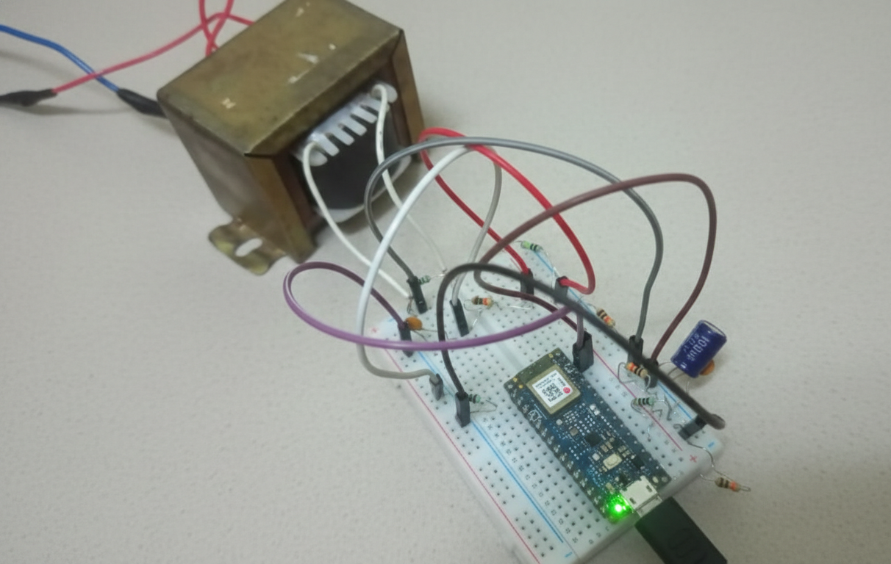
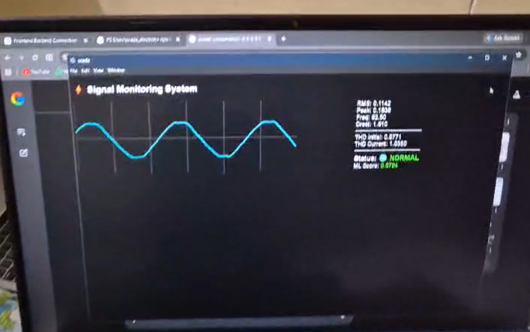
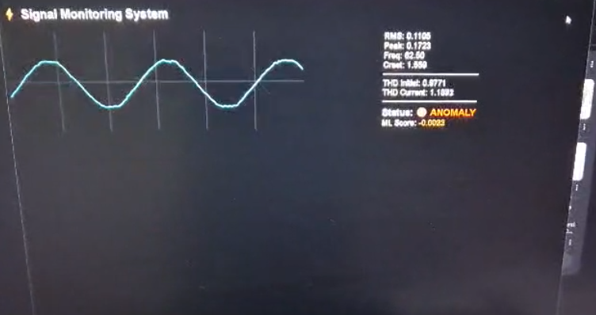

# Real-Time Embedded Power Quality Monitor & SCADA System

> An industrial-grade data acquisition and supervisory monitoring system for real-time waveform visualization, power quality analysis, and ML-based anomaly detection — built with an Arduino Nano 33 BLE and a Python/Electron stack.

---

## What This Project Does

Electrical signals are rarely as clean as we'd like them to be. Harmonics creep in, distortion builds up, and abnormal events go unnoticed until something fails.

This system was built to change that. It monitors electrical signals in real time, computes key power quality metrics (RMS, THD, Crest Factor), runs an unsupervised ML pipeline to catch anomalies before they become problems, and visualizes everything on a live SCADA dashboard — all the way from a microcontroller's ADC pin to an Electron desktop app.

---

## Features

### Hardware & Embedded
- **High-resolution acquisition** — 12-bit ADC sampling at 5 kHz on the Arduino Nano 33 BLE Sense Rev2
- **Precision analog front-end**
  - Mid-supply biasing (~1.65V) to center AC signals within ADC range
  - Voltage divider for safe input scaling
  - RC low-pass anti-aliasing filter for signal integrity
  - Transformer-isolated AC sensing for safe mains monitoring

### Signal Processing & ML (Python Backend)
- **FFT analysis** — frequency domain decomposition of the sampled waveform
- **THD computation** — Total Harmonic Distortion calculated from harmonic content
- **Standard metrics** — RMS, Peak-to-Peak, Frequency, and Crest Factor
- **Anomaly detection** — Isolation Forest model trained on historical baseline data; outputs a confidence score for system stability
- Powered by NumPy, SciPy, and Scikit-Learn

### SCADA / HMI (Supervisory Layer)
- **Electron desktop dashboard** featuring:
  - Live waveform oscilloscope (Canvas-based)
  - Live FFT spectrum visualization
  - Power quality metrics panel
  - Visual alarm indicators — 🟢 NORMAL / 🔴 ANOMALY

### Docker & Containerization
- **Dockerized Python backend** — runs signal processing and Isolation Forest anomaly detection in an isolated, reproducible container environment
- **Dependency management** — packages Python dependencies and baseline dataset using a custom Dockerfile
- **Electron integration** — Electron launches the Docker container and exchanges telemetry through standard input/output

---

## System Circuit

<p align="center">
  
</p>


## System Architecture

```
[ Signal Source ]
       ↓
[ Analog Front-End ]         →  Bias + Scale + Filter
       ↓
[ Arduino Nano 33 BLE ]      →  5 kHz Sampling + Feature Extraction
       ↓
[ Serial Telemetry (UART) ]  →  Frame-based protocol: 'W' (Waveform), 'F' (Features)
       ↓
[ Python Backend ]           →  FFT + THD + Isolation Forest ML
       ↓
[ SCADA HMI (Electron) ]     →  Real-time Visualization & Alarming
```

---


## Tech Stack

| Domain | Technologies |
|---|---|
| Embedded | Arduino (C++), PlatformIO, nRF52 architecture |
| Backend | Python, NumPy, SciPy (FFT), Scikit-Learn (ML), Pandas |
| Frontend | Electron, JavaScript, HTML5 Canvas |
| Containerization | Docker, Dockerfile, containerized Python backend |
| Data | CSV logging, Serial UART @ 115200 baud |


---

## Project Structure

```text
├── prototype_code/
│   ├── main.cpp                 # Arduino firmware — sampling and telemetry
│   ├── scada_backend.py         # Python engine — ML, THD, and signal processing
│   ├── requirements.txt         # Python dependencies for Docker
│   ├── Dockerfile               # Docker image configuration for the backend
│   └── scada_electron/          # Electron desktop HMI source
├── dataset/
│   └── ...                      # Baseline data and dataset-generation scripts
└── output/
    └── ...                      # Visualizations and demo outputs
```

---

## Docker Setup

The Python signal-processing and anomaly-detection backend can run in a Docker container, providing a reproducible environment for its Python dependencies.

### Prerequisites

- Docker Desktop installed and running
- Git
- Node.js and npm for the Electron desktop application
- Arduino Nano 33 BLE for live hardware telemetry

### Build the Backend Image

Run these commands from the repository root:

```powershell
docker build -t scada-backend -f prototype_code/Dockerfile .
```

### Test the Backend with Synthetic Data

The backend accepts waveform (`W`) and feature (`F`) records through standard input.

```powershell
"W,0,1,2,3,4,5,6,7,8,9`nF,100,50,10,2" | docker run --rm -i scada-backend
```

A successful test should produce a model initialization message and a status response, such as `STATUS,ANOMALY,...`. The classification shown depends on the input and trained model.

### Run the Electron Dashboard

The Electron application runs on the Windows host and launches the Dockerized Python backend.

```powershell
cd prototype_code/scada_electron
npm install
npm start
```

Ensure Docker Desktop is running before launching the application. The current Electron configuration expects the Arduino's serial port to be `COM8` at `115200` baud.

### Architecture

- **Embedded layer:** Arduino firmware samples the signal and sends telemetry over UART.
- **Desktop layer:** Electron reads serial data and updates the SCADA dashboard.
- **Backend layer:** Docker runs Python signal processing, THD calculation, and Isolation Forest anomaly detection.

The Python backend has been tested independently in Docker with synthetic input. End-to-end telemetry and dashboard integration should be verified with the Arduino connected.

---

## Contributors

This project was a collaborative effort combining embedded engineering with advanced data processing:

- **AJ** *(Project Lead)* — Hardware architecture, analog front-end design, and Arduino C++ firmware development and python backend(ML pipelines and docker containerization).
- **Purusharth** — Developed the SCADA Electron interface and assisted in the development of python backend processing engine (ML pipeline, FFT, THD logic) and docker.

---

## ⚠️ Safety Notice

This project involves signals derived from mains-level AC voltages. **High voltage is lethal.**

- Always use a step-down isolation transformer (e.g., 220V → 6V AC output)
- Never connect the Arduino or any microcontroller directly to mains without proper optical or magnetic isolation
- This project is intended for educational and research purposes only

---

---

## Output & Results

<p align="center">
  
</p>

<p align="center">
  
</p>

<p align="center">
  
</p>

---

*Developed as a prototype for advanced Power Quality Monitoring and Predictive Maintenance.*
